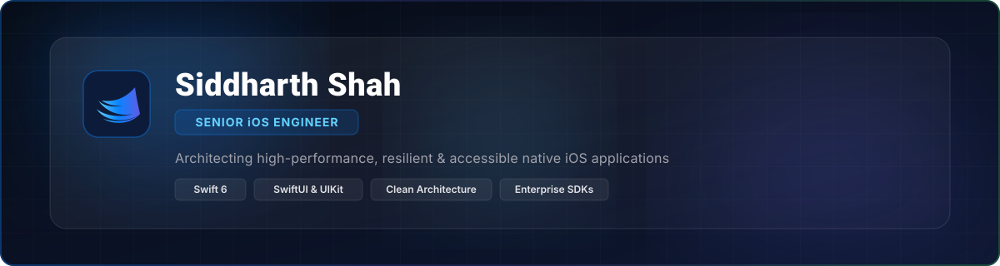

<!--
  Siddharth Shah | iOS Engineer
  Profile README — Apple-inspired dark glass aesthetic
-->

  

  

  
  &nbsp;
  
  &nbsp;
  

  
  
  

  

## 👋 Hello, I'm Siddharth

**Senior iOS Engineer · Swift Specialist · iOS Architect**

I build scalable, reliable and maintainable native iOS applications. With **7+ years of experience**, my work spans modern Swift, legacy Objective-C, modular SDKs and enterprise mobile architecture.

I care about the engineering beneath the interface: predictable concurrency, secure authentication, resilient offline experiences, measurable performance and APIs that remain easy to evolve.

  
  
  
  

## 🧭 What I work on

<table>
  <tr>
    <td width="50%" valign="top">
      <h3>🧱 iOS Architecture</h3>
      Modular systems, Clean Architecture, VIP/MVVM, dependency injection and maintainable boundaries.
    </td>
    <td width="50%" valign="top">
      <h3>⚙️ Swift & Concurrency</h3>
      Swift 6, structured concurrency, strict concurrency adoption and safe asynchronous APIs.
    </td>
  </tr>
  <tr>
    <td width="50%" valign="top">
      <h3>📦 SDK Engineering</h3>
      Reusable frameworks, Swift Package Manager, public API design and integration workflows.
    </td>
    <td width="50%" valign="top">
      <h3>🔐 Security & Identity</h3>
      OAuth 2.0 / PKCE, JWT lifecycle, Keychain, certificate pinning and secure session handling.
    </td>
  </tr>
  <tr>
    <td width="50%" valign="top">
      <h3>📴 Offline-First Apps</h3>
      Local persistence, synchronization, resilient workflows and network-aware experiences.
    </td>
    <td width="50%" valign="top">
      <h3>🚀 Quality & Performance</h3>
      Instruments, memory management, XCTest, accessibility and launch/rendering optimization.
    </td>
  </tr>
</table>

## 🛠️ Technology toolkit

**Apple platforms & languages**

  
  
  
  
  

**Architecture & engineering**

  
  
  
  
  

**Networking, data & delivery**

  
  
  
  
  
  
  
  
  

## 🚀 Selected projects

A selection of public projects that demonstrate my approach to native iOS development, architecture and problem-solving.

<table>
  <tr>
    <td width="50%" valign="top">
      <h3><a href="https://github.com/sidshah13/Supertal-Practical">Supertal-Practical</a></h3>
      A Swift sample app that loads user directory data from a REST API and presents list/detail navigation.
        
      <b>Stack</b> · Swift · Clean VIP · Alamofire · SDWebImage · XCTest
       
      Protocol-driven presentation logic, image caching and network reachability handling.
    </td>
    <td width="50%" valign="top">
      <h3><a href="https://github.com/sidshah13/GooglePlaceAutoCompleteDemo">GooglePlaceAutoCompleteDemo</a></h3>
      A reusable example of integrating Google Places autocomplete into a native iOS search flow.
        
      <b>Stack</b> · Swift · UIKit · Google Places SDK · Core Location
       
      Decoupled search UI, input throttling and delegate-based communication.
    </td>
  </tr>
  <tr>
    <td width="50%" valign="top">
      <h3><a href="https://github.com/sidshah13/Grocery-App">Grocery-App</a></h3>
      An Objective-C grocery application demonstrating UIKit and legacy iOS code maintenance.
        
      <b>Stack</b> · Objective-C · UIKit · Foundation · Core Graphics
       
      Legacy code stewardship and multi-contributor project experience.
    </td>
    <td width="50%" valign="top">
      <h3><a href="https://github.com/sidshah13/SampleScroll">SampleScroll</a></h3>
      A native iOS example focused on scroll views, layout behavior and dynamic content sizing.
        
      <b>Stack</b> · Swift · UIKit · UIScrollView · Auto Layout
       
      Explores layout calculations and smooth scrolling for changing content.
    </td>
  </tr>
</table>

## 🏢 Enterprise engineering

Commercial client work is covered by confidentiality agreements. The following summarizes the engineering areas I have worked across without disclosing proprietary implementation details.

- **Enterprise applications** — Multi-module native iOS applications and maintainable feature architecture.
- **SDK & component development** — Reusable Swift frameworks for authentication, networking and shared UI capabilities.
- **Identity & security** — OAuth 2.0 PKCE, JWT token lifecycle, Keychain storage and certificate pinning.
- **Offline storage & synchronization** — Local persistence with Core Data / SQLite and background synchronization workflows.
- **Real-time communication** — WebSocket-based messaging and live status updates.
- **Performance & reliability** — Instruments profiling, memory ownership, retain-cycle investigation and launch/rendering improvements.
- **Accessibility** — VoiceOver, Dynamic Type, accessible touch targets and inclusive interaction patterns.

## 🗺️ Career journey

| Period | Engineering focus |
|:--|:--|
| **2015–2019** | iOS foundations · Objective-C · Swift adoption · UIKit · Core Graphics |
| **2019–2023** | Native iOS development · Clean Architecture · Enterprise apps · Authentication SDKs |
| **2023–2026** | Modern Swift · SwiftUI · Swift 6 concurrency · SPM modularization |
| **2026+** | Advanced systems · On-device AI · Spatial computing · Framework design |

## 🔬 Current interests

- **Swift 6 and concurrency** — Safer asynchronous code, strict concurrency and clear actor boundaries.
- **AI on Apple platforms** — Exploring on-device intelligence and practical AI-assisted workflows in native apps.
- **Developer experience** — Build tooling, automation, static checks and documentation that stays aligned with code.
- **Framework design** — Small public APIs, explicit dependencies and reusable components.
- **Performance** — Memory ownership, startup time, rendering and efficient background work.

## 💡 Engineering principles

> Build for the engineer who has to extend the codebase next, not just for the user who opens the app today.

- **Small surface area** — Keep public APIs focused and module responsibilities clear.
- **Explicit dependencies** — Prefer clear contracts and dependency injection over hidden side effects.
- **Performance is a feature** — Measure before optimizing; protect responsiveness and resource usage.
- **Accessibility by design** — Treat inclusive interaction as a core requirement, not a finishing task.
- **Testable boundaries** — Keep business rules independently testable and easy to reason about.
- **Evolution over cleverness** — Choose understandable solutions that can adapt as requirements change.

## 📈 GitHub activity

  
  

  

  <picture>
    <source media="(prefers-color-scheme: dark)" srcset="assets/github-contribution-grid-snake-dark.svg" />
    <source media="(prefers-color-scheme: light)" srcset="assets/github-contribution-grid-snake.svg" />
    
  </picture>

<!--START_SECTION:activity-->
<!--END_SECTION:activity-->

## 🤝 Let's connect

I'm always interested in thoughtful conversations about Swift, iOS architecture, developer tooling, performance and practical AI integration.

  
  
  
  

  
  Designed with clarity · Built with precision · Always evolving

